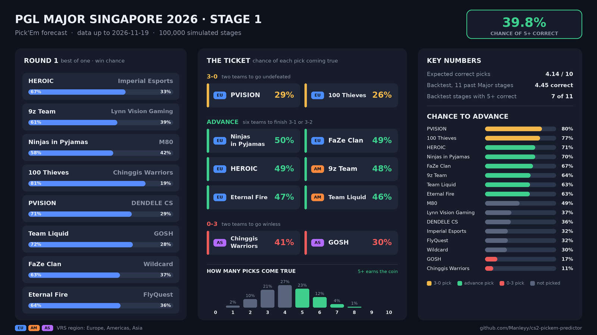

# CS2 Major Pick'Em predictor

Predicts every match of a Valve Major Swiss stage and picks the 10 Pick'Em
slots (2 × 3-0, 6 × advance, 2 × 0-3) that maximise the chance of getting at
least 5 right. Configured for **PGL Major Singapore 2026, Stage 1** (24-27 Nov).

```
Valve VRS repo ──┐                                       ┌─► match model (logistic regression)
manual results ──┼─► features (VRS, live Elo, head-to-   ┤
(HLTV optional) ─┘    head, region strength)             └─► 100k Swiss simulations ─► Pick'Em optimiser
```

**Backtested on 11 past Major Swiss stages:** 4.45 correct picks per stage on
average and 5+ correct in 7 of 11 stages, against 4.27 and 5/11 for picking
straight down the VRS ranking. Details under [The model](#the-model).

## Results: PGL Major Singapore 2026, Stage 1



| Slot | Picks |
|---|---|
| 3-0 | PVISION, 100 Thieves |
| Advance (3-1 or 3-2) | Ninjas in Pyjamas, FaZe Clan, HEROIC, 9z Team, Eternal Fire, Team Liquid |
| 0-3 | Chinggis Warriors, GOSH |

40% chance of 5 or more correct picks (expected 4.1 of 10), from 100,000
simulated stages with data up to 19 Nov 2026. Full odds for every team are in
[output/picks.md](output/picks.md). The image is redrawn by every
`python -m pickem predict` (or alone with `python -m pickem board`).

## Quick start (Windows, VS Code)

1. Open this folder in VS Code (`File > Open Folder`).
2. `Terminal > Run Task... > setup: create venv + install` (creates `.venv`, installs everything).
3. Select the interpreter if asked: `Ctrl+Shift+P > Python: Select Interpreter > .venv`.
4. Download Valve's ranking data once: **Run and Debug (F5) > Data: update VRS from Valve**
   (or `python -m pickem fetch-vrs`; about 150 MB, needs `git` or downloads a zip).
5. Press **Ctrl+Shift+B** (runs `pickem all`), or pick a configuration in **Run and Debug (F5)**.

Or in a terminal:

```powershell
py -3 -m venv .venv
.venv\Scripts\activate
python -m pip install -e ".[hltv,dev]"
python -m pickem fetch-vrs    # download + parse Valve's VRS data (once)
python -m pickem all          # train + predict
python -m pickem backtest     # replay 11 past Major stages (~3 min)
python -m pytest -q           # 12 tests
```

On Windows with Smart App Control, run pip and the tool through Python
(`python -m pip`, `python -m pickem`): the `pip.exe` / `pickem.exe` launchers
can be blocked. Python 3.13 is recommended; very new Python versions may lack
prebuilt numpy/scikit-learn files.

Change the number of simulations for one run with `--sims`:

```powershell
python -m pickem predict --sims 100000
```

Results go to `output/`:

| file | what |
|---|---|
| `board.png` | the forecast as an image (picks, round 1, chance to advance) |
| `picks.md` | the 10 picks, round 1 odds, record probabilities, team inputs |
| `predictions.json` | everything above, machine readable (e.g. for a website) |
| `record_probabilities.csv` | P(3-0 … 0-3) and P(advance) per team |
| `matrix_bo1.csv`, `matrix_bo3.csv` | head-to-head win probabilities for every pair |
| `team_profiles.csv` | the inputs each team gets |
| `validation.md` | how well the model does on held-out matches |
| `backtest.md` | how the model would have done at past Majors (after `backtest`) |

## The data and where it comes from

**Valve VRS (no scraping needed).** Valve publishes its ranking in
[ValveSoftware/counter-strike_regional_standings](https://github.com/ValveSoftware/counter-strike_regional_standings).
Each monthly snapshot has team points, and each team's details page lists every
match that counted (date, opponent, W/L). Parsed together that gives
**37,399 series from Feb 2024 to 1 Nov 2026**, which is the training set.
The data is not stored in this repository: `python -m pickem fetch-vrs`
downloads Valve's repository into `data/raw/vrs/` and parses it into
`data/processed/`. Run it again after each monthly release (first Monday of the
month) to update.

**HLTV ranking (optional).** HLTV has no API and sits behind Cloudflare, and
its data may not be redistributed, so no HLTV data is included here. The model
does not need it (see the HLTV test under [The model](#the-model)). To add it
yourself:

- `python -m pickem hltv-fetch` downloads one ranking every 4 weeks since Sept 2024
  (about 30 pages) with a 4-8 s delay and caches each page. Add
  `--results-from 2026-11-02` to also get recent results.
- If HLTV blocks it ("Just a moment..."), the command stops and prints the URL
  and the file name it expected. Open the URL in your browser, `Ctrl+S` as
  *Webpage, HTML only* to that path, and run `python -m pickem hltv-parse`.
  Ranking URLs look like `https://www.hltv.org/ranking/teams/2026/november/16`.
- Keep it to that small number of pages, for personal use.

**Recent matches by hand.** VRS data ends on 1 Nov. Anything you add to
`data/manual/extra_matches.csv` (date, winner, loser, fmt) after that date
counts towards form.

## The model

Each match becomes "team A minus team B" features, so **opponent strength is in
every feature**. The model uses five inputs:

| input | definition |
|---|---|
| `vrs_diff` | VRS points gap / 100, from the last snapshot before the match |
| `elo_diff` | live Elo gap / 100. Starts at each team's VRS points, then updates after every series (K = 48). A win over a strong team gains a lot, a loss to a weak team costs a lot, so this is the model's **opponent-adjusted form**, and it is never weeks out of date like VRS. At each monthly VRS release Elo is pulled 10% back toward the VRS points (`elo_revert`), so old results slowly fade |
| `h2h` | head-to-head: A's results above expectation against B over the last year, shrunk toward 0 |
| `region_americas`, `region_asia` | learned strength offset of a region compared with Europe. Learned only from cross-region matches. Current values: an Americas team is about 100 rating points weaker than a European team with the same VRS points and Elo, an Asian team about 90 |

Everything uses data from **before** each match only.

Tested and switched off (still available in `config.yaml` under `model.features`):
`form_diff` and `sos_diff` (90-day form and strength of schedule) improve
everyday predictions but make predictions **at Majors worse** in the backtest;
`hltv_diff` never helped; `xreg_diff`, `form_short_diff` and `activity_diff`
didn't help either.

The model is a logistic regression with no intercept, trained on both
orientations of each match, so P(A beats B) = 1 − P(B beats A). The training
series are mostly Bo3, so the output is treated as a Bo3 probability and
converted to a per-map (Bo1) probability with P(Bo3) = p²(3 − 2p).

**HLTV.** The HLTV test was run with 31 HLTV rankings (every 4 weeks from
Sept 2024, plus 9 and 16 Nov 2026) collected with `hltv-fetch`; they are not
included in this repository. With `use_hltv: auto` the model is trained with
and without HLTV rank and keeps it only if it lowers held-out log loss. It
didn't, so HLTV is off. Set `use_hltv: yes` to force it in.

**Recent matches.** `data/manual/extra_matches.csv` holds the 28 series the
Stage 1 teams played from 2 to 23 Nov 2026 (results only). They update Elo and
head-to-head.

### Test 1: everyday matches (fit before 1 May 2026, tested on 4,060 later series)

| model | log loss | accuracy | top-60 accuracy |
|---|---|---|---|
| coin flip | 0.693 | 50.0% | 50.0% |
| Valve's formula on VRS points (no fitting) | 0.679 | 61.5% | 57.5% |
| VRS (fitted) | 0.656 | 61.5% | 57.5% |
| VRS + form + SOS (first version) | 0.647 | 62.3% | 58.9% |
| all 7 inputs (incl. form + SOS) | 0.641 | 63.1% | 59.8% |
| **current 5 inputs** | **0.640** | **63.5%** | **59.9%** |

### Test 2: past Majors (`python -m pickem backtest`)

11 Swiss stages (Shanghai 2024, Austin 2025, Budapest 2025, Cologne 2026). For
each stage the model is refit on data from before the stage only, then it
simulates the stage, makes the 10 picks and is scored against the real results
(`data/backtest/majors.yaml`, from Wikipedia).

| model | avg correct picks | stages with 5+ | record log score ↑ | advance Brier ↓ | match log loss ↓ |
|---|---|---|---|---|---|
| pick by seed (Wikipedia listing order) | 3.55 | 3/11 | | | |
| pick straight down VRS points | 4.27 | 5/11 | | | |
| pick straight down HLTV rank (needs HLTV data) | 4.45 | 6/11 | | | |
| VRS only | 4.09 | 6/11 | −1.667 | 0.208 | 0.651 |
| VRS + form + SOS (first version) | 3.64 | 3/11 | −1.694 | 0.215 | 0.660 |
| all 7 inputs (incl. form + SOS) | 3.55 | 4/11 | −1.676 | 0.209 | 0.651 |
| **current 5 inputs** | **4.45** | **7/11** | **−1.646** | **0.204** | **0.641** |

Against simply picking down a ranking, the model ties HLTV-rank picking on
average picks (4.45) and is slightly ahead of VRS picking (4.27); with 11
stages neither gap is statistically meaningful. Its real advantage is the
quality of its probabilities (log loss 0.640 vs 0.656 for VRS and 0.667 for
HLTV rank on everyday matches), which is what lets it estimate P(5+) and
choose picks that work well together.

11 stages is a small sample and Pick'Em counts are noisy (one Bo1 upset can
cost two picks). The three columns on the right use every team and every
match, so they are steadier. The model is well calibrated at Majors:
favourites it gave ~62% won 62.0% of 358 real matches.

**Bo1 stretch.** Bo1 favourites win more often than an average map suggests,
because the veto leaves the underdog no comfort pick. Bo1 log-odds are
therefore multiplied by 1.6 (`bo1_stretch`). This finding comes from
[Leclowndu93150/pickem-prediction-model](https://github.com/Leclowndu93150/pickem-prediction-model)
(fitted on 455 real Bo1s); on our backtest, 1.0 → 1.6 improved every stage
score (record log score −1.665 → −1.656, advance Brier 0.207 → 0.203,
stages with 5+ correct 5 → 6).

## The simulation

`swiss.py` plays the stage 100,000 times with Valve's Major rules: round 1 as
published (1v9, 2v10 …), then pairings inside each W-L group by Buchholz
difficulty and seed, top versus bottom, no rematches. Groups of six in rounds
4-5 use Valve's 15-pattern priority table (taken, with credit, from
[Leclowndu93150/pickem-prediction-model](https://github.com/Leclowndu93150/pickem-prediction-model),
MIT licence, where it reproduces all 99 real Cologne 2026 pairings). Matches that can advance
or eliminate a team are Bo3, the rest Bo1.

The optimiser then scores candidate pick sets against all 100,000 simulated
stages and hill-climbs on P(≥ 5 correct). That can differ from just taking the
highest single probabilities, because picks are correlated (a 3-0 pick that
goes 3-1 also costs an advance slot).

## During the stage

Add results to `config.yaml` as they happen and run `python -m pickem predict`:

```yaml
  played:
    - [HEROIC, Imperial Esports]   # [winner, loser], in play order
    - [Lynn Vision Gaming, 9z Team]
```

To force a pick (say you've already locked one in game):
`locked: {"3-0": [PVISION]}`. Change the `seeds`, `round1` and `date` fields
for Stage 2.

## Project layout

```
config.yaml            tournament, Swiss rules, Pick'Em rules, aliases, model settings
src/pickem/vrs.py      Valve repo download + parsing
src/pickem/hltv.py     HLTV parsing, polite fetching, manual fallback
src/pickem/features.py ranking / opponent / form features (time-safe)
src/pickem/model.py    logistic model, validation, Bo1/Bo3 conversion
src/pickem/swiss.py    Swiss Monte Carlo
src/pickem/optimize.py Pick'Em optimiser
src/pickem/cli.py      commands
tests/                 pytest
```

## Ideas for later

- Map-level data (veto, map pool win rates) from HLTV match pages. Stage 1 is Bo1, so the map matters a lot.
- Roster changes: VRS lists the roster, so form could reset when 2+ players change.
- LAN vs online weighting in form.
- A small HTML page reading `output/predictions.json` for a website.

## Data sources, credits and license

- Rankings and match history: Valve's
  [Counter-Strike Regional Standings](https://github.com/ValveSoftware/counter-strike_regional_standings),
  downloaded by `fetch-vrs` (not redistributed here).
- Past Major results in `data/backtest/majors.yaml`: the English Wikipedia
  articles for each Major (CC BY-SA 4.0).
- Bo1 stretch factor and Valve's six-team pairing table:
  [Leclowndu93150/pickem-prediction-model](https://github.com/Leclowndu93150/pickem-prediction-model)
  (MIT), see [THIRD_PARTY_NOTICES.md](THIRD_PARTY_NOTICES.md).
- Not affiliated with Valve, HLTV, PGL or any team.

The code is released under the [MIT License](LICENSE).
